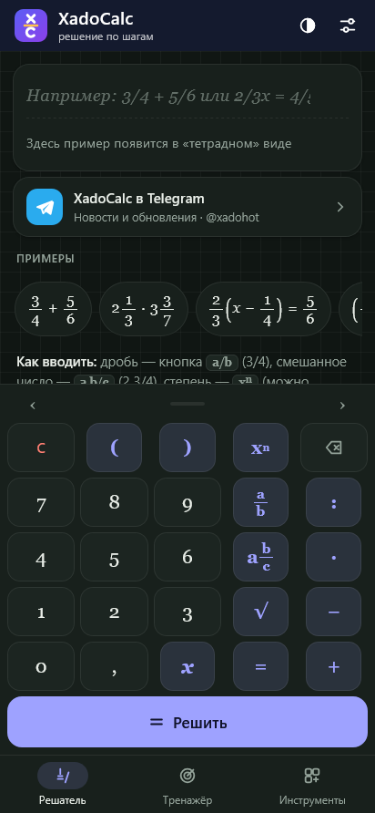
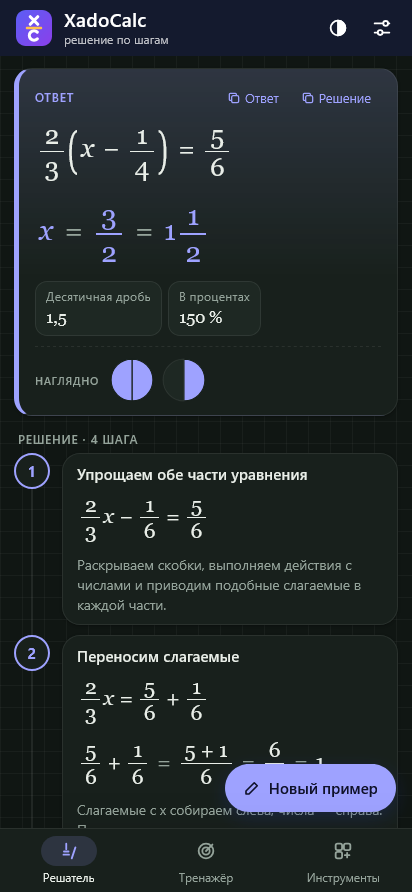
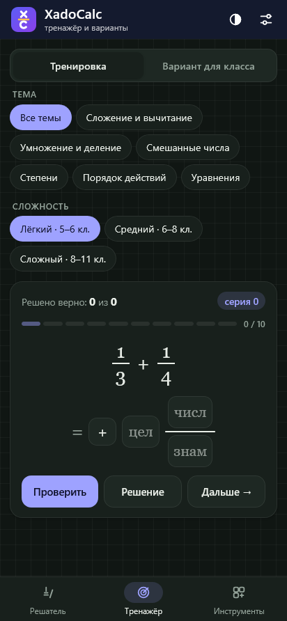
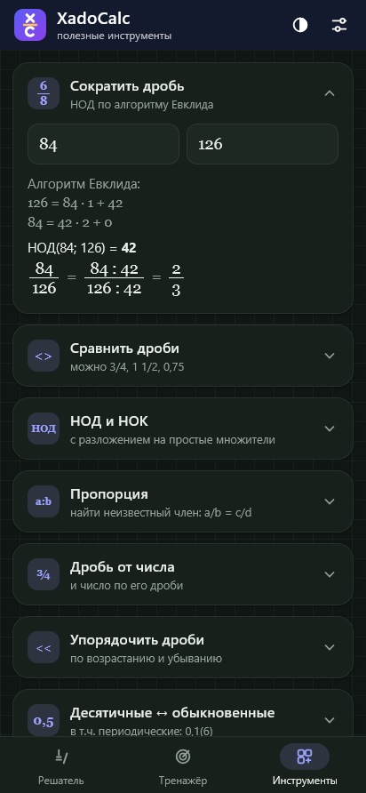
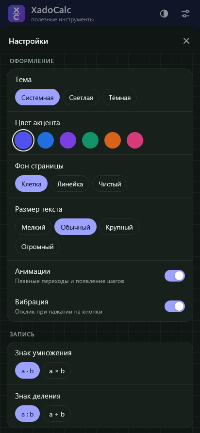
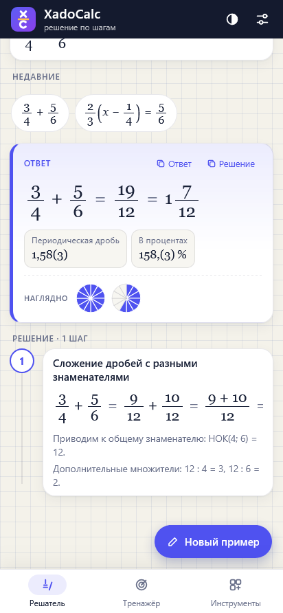

# XadoCalc

Решатель дробей для школы с решением по шагам. Android 10 и новее, работает без интернета.

**[Скачать APK](https://github.com/xadoho/XadoCalc/releases/latest)** · Android 10+ · Канал: [t.me/xadohot](https://t.me/xadohot)

  
  
  

  
  
  

## Что умеет

- обыкновенные, смешанные, десятичные и периодические дроби: `3/4`, `2 1/3`, `0,25`, `0,1(6)`
- степени (отрицательные, нулевая, дробные), квадратный корень, скобки, порядок действий
- линейные уравнения с дробями: `2/3(x - 1/4) = 5/6`, с проверкой корня
- решение по шагам с пояснениями: НОК, дополнительные множители, сокращение
- ответ в виде дроби, смешанного числа, десятичной дроби, процентов и закрашенных долей
- тренажёр: 7 тем, 3 уровня, серия из 10 заданий с оценкой и временем
- варианты для класса: один или два варианта по 5–20 заданий с ответами
- инструменты: сокращение, сравнение, упорядочивание, НОД и НОК, пропорция, дробь от числа, перевод десятичных дробей
- настройки: тема, цвет, фон, размер текста, знаки действий, подробность решения

## Файлы

| Путь | Что внутри |
|---|---|
| `app/assets/engine.js` | математика: разбор выражений, точная арифметика, шаги решения |
| `app/assets/app.js` | интерфейс |
| `app/assets/index.html` | разметка и стили |
| `app/res` | иконка и тема Android |
| `app/AndroidManifest.xml` | манифест |
| `build/gen_dex.py` | classes.dex (Activity с WebView) |
| `build/pack.py` | упаковка APK |
| `build/build.sh` | сборка и подпись |

Интерфейс можно открыть и в браузере: `app/assets/index.html`.

## Сборка

1. Положите в папку `tools` файлы `aapt2` и `android.jar` (API 29 или новее).
2. Запустите `build/build.sh`. При первом запуске будет создан ключ подписи.
3. Готовый файл: `build/out/XadoCalc.apk`

## Лицензия

MIT, см. файл [LICENSE](LICENSE).
